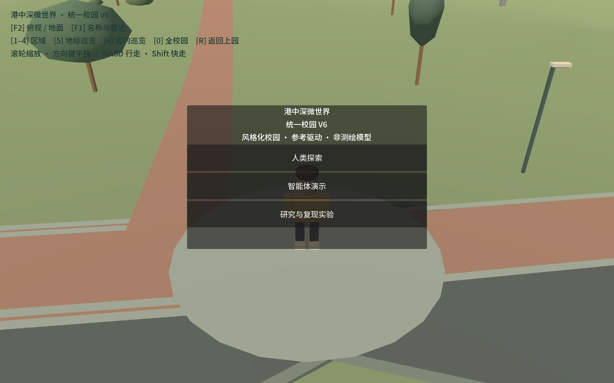
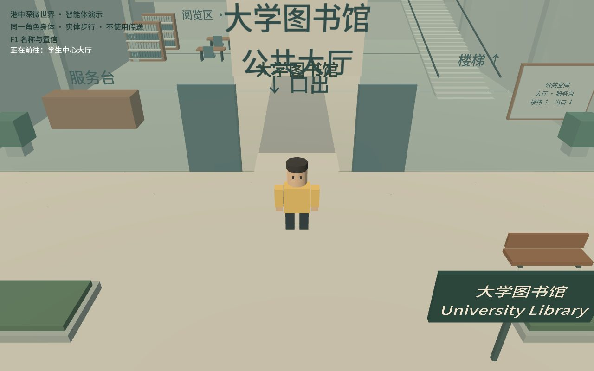
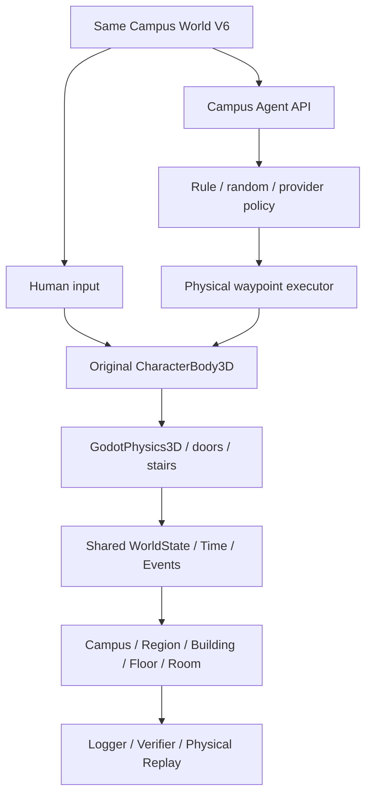

> 历史 V6 说明存档。当前入口、版本与验证状态以根目录 README.md 为准。原有研究线索保留。

# CUHK-Shenzhen MicroWorld

A stylized, reference-grounded 3D CUHK-Shenzhen campus world shared by humans and software agents.

**Unified Campus V6 / 2.0.0-beta1** is the current main product, accepted from a fresh remote-main clone. Human and Agent inhabit the same geometry, doors, stairs, interiors and physics world.

- Upper / Middle / Fairy Lake / Lower campus.
- 44 modeled exterior buildings and ten enterable public interiors.
- Continuous physical walking, indoor/outdoor transitions and public stairs.
- Human exploration and rendered Agent navigation with the original CharacterBody3D.
- Public semantic locations, structured observations/actions, time/events.
- Event logs, independent task verification and physical action replay.
- Historical RC1 reproduction retained separately.




## 本机目录与入口

2026-10-10 · **V32 十周年参照精修**：东门至学生中心新增 35 个铺地/草地分区，修正知新楼缺失翼和高低楼体，道远楼改用专用格栅入口及弧形玻璃翼。两轮集中验证共 22 段步行通过。见 [参照与当前画面](../docs/ANNIVERSARY_REVIEW.html)及 [年份依据、实现与剩余精修](../docs/ANNIVERSARY_REFINEMENT_V32.md)。以下较早记录中的数量为当时快照。

官方全景建造继续完善大学图书馆曲面外墙、地面层共享门厅、2F 楼梯平台和池边入口，并补齐 8 栋相邻建筑架空层铺地。当前 24 组模型、40 条路线、32 个地点。见 [图书馆与下层空间](../docs/LIBRARY_PUBLIC_SPACES.md)。

2026-10-09：官方全景建造新增 **11 栋专用实例外观**，包含张岭彬楼、两座实验楼、逸夫东/西座，以及诚道、乐天、知仁、知新、道远楼和科研楼背面。当前 24 组模型、39 条路线、29 个地点。见 [实例建筑与验收](../docs/LANDMARK_BUILDINGS.md)。

2026-10-08：**官方全景建造 · 东门起点** 已扩展到主广场、科研楼、体育馆和田径场，当前 24 组模型、33 条路线、26 个导航地点。教学 A/B/C 增加凹窗、窗台、柱梁、栏杆和可走楼梯，地面加入分材质铺地与远景细节衰减。可直接运行 `启动入口/启动官方全景建造.cmd`；见 [下园扩展与细化](../docs/LOWER_CAMPUS_EXPANSION.md)及 [建造与方位依据](../docs/OFFICIAL_VISUAL_BUILD.md)。

2026-10-08：已加入按实景参考制作的外墙细部、图书馆遮阳格栅、步行铺地与光照更新。见 [外景与走道打磨](../docs/EXTERIOR_VISUAL_POLISH.md)。

双击根目录 `启动游戏.lnk` 或 `打开 Godot 编辑器.lnk`。独立探索、Agent 演示及 RC1 启动器统一放在 `启动入口/`。

- `docs/`：项目说明、贡献指南、更新记录、验收记录与评测协议。
- `references/`：参考资料与来源；`tests/`：测试及本机验收证据；`tools/`：开发和验收工具。
- `assets/`、`world/`、`player/`、`npc/`、`ui/`、`autoload/`、`systems/`、`agents/`、`tasks/`：Godot 源码和资源，按原引用路径保留。
- `.tools/`、`.godot/`：隐藏的本机引擎和缓存。

## Quick start

1. Clone this repository and install **Godot 4.5.1** (Compatibility renderer).
2. Import `project.godot` in Godot and Run Project.
3. Choose **人类探索**, **智能体演示**, or **研究与复现实验**.

Windows shortcuts:

| Launcher | Mode |
|---|---|
| `启动入口/启动港中深MicroWorld.cmd` | Chinese product menu |
| `启动入口/启动官方全景建造.cmd` | Official panorama-based lower-campus build, East Gate origin |
| `启动入口/启动人类探索.cmd` | Human Explore |
| `启动入口/启动Agent演示.cmd` | Physical Agent Demo |
| `启动入口/启动RC1复现实验.cmd` | Historical research scene |

The launchers discover `godot.exe` / `godot4.exe` on PATH or a local `.tools/godot` engine. An explicit engine is supported:

```powershell
powershell -File tools/LaunchProduct.ps1 -GodotPath "D:/Godot/Godot_v4.5.1-stable_win64.exe"
```

Human controls: WASD relative to the camera, Shift to jog, right mouse drag to orbit, mouse wheel to zoom, Tab for phone, E to interact, F1 confidence, F2 ground/overview. Human exploration now uses 2.5× movement speed, a clickable upper-left minimap and an optional four-stop campus tour. Agent and RC1 keep their original speed. See [local exploration update](../docs/HUMAN_EXPLORATION_UPDATE.md). All player-facing content is Simplified Chinese. Agent Demo follows the same physical body across campus and inside representative interiors; no teleport recovery.

## Shared architecture



Public campus knowledge is separate from nearby perception. Structured observations do not expose navigation graph, shortest paths, verifier or hidden NPC perception. V6 does not claim autonomous visual navigation.

## Development checks

With Python 3 and Godot 4.5.1 installed, optionally set `GODOT_PATH` to the engine executable:

```powershell
python tools/check_unified_campus.py
python tools/check_unified_campus.py --qa --rc1
python tools/check_unified_campus.py --render
python tools/check_unified_campus.py --human
```

Tests include 16 integration tasks, ten building entry/exit/re-entry routes, stairs, decision latency, replay, random/mock compatibility, 50 mixed episodes and continuous cross-campus routes. These are scripted infrastructure acceptance tests, not first-time human testing or external-model scores.

## Scope and reconstruction philosophy

Geometry records distinguish **verified**, **inferred** and **placeholder**, with provenance and replaceability. V6 preserves V5 world anchors. All ten interiors are inferred public-space approximations; floor labels and dimensions are not surveyed. High Table is a prototype event interior, not a verified permanent venue. Visual shuttle-stop placeholders do not imply operational V6 boarding or a simulated bus.

The goal is visual resemblance, spatial plausibility, physical navigation and reproducible interaction. This is **not a survey-grade GIS/BIM digital twin**, not a 1:1 campus reconstruction, and not endorsed by the university.

## Research and historical baseline

`v1.0.0-rc1` remains immutable. Its journey-v1 benchmark, transport abstraction and historical scores are reproducible, but no longer the default product world. Run `world/MainWorld.tscn` explicitly, or check out the tag for its original project configuration. No RC1 scores are attributed to V6; future V6 research benchmarks require a separate protocol.

Historical world branches and [milestone documents](../docs/INDEX.md) are retained. Old development launchers are in `tools/launchers/archive/`.

## Documentation

- [Unified Campus V6](../docs/UNIFIED_CAMPUS_V6.md)
- [Main release acceptance](../docs/MAIN_PRODUCT_V6_RELEASE.md)
- [Human / Agent parity](../docs/HUMAN_AGENT_WORLD_PARITY.md)
- [Agent migration audit](../docs/V6_AGENT_MIGRATION_AUDIT.md)
- [Documentation index](../docs/INDEX.md)

## Assets, copyright and license

Project-authored geometry and code are tracked. Some original photos, official panorama images and other reference assets remain local for copyright, licensing or size reasons. Metadata and notes do not grant permission to redistribute their sources. Recovered Virtual Campus / GTA assets are not redistributed; reuse requires separate license confirmation. Existing third-party notices remain applicable. Campus names and identity do not imply university endorsement.

**License pending / All rights reserved unless otherwise stated.** No blanket new license is applied to reference-derived or third-party material.
